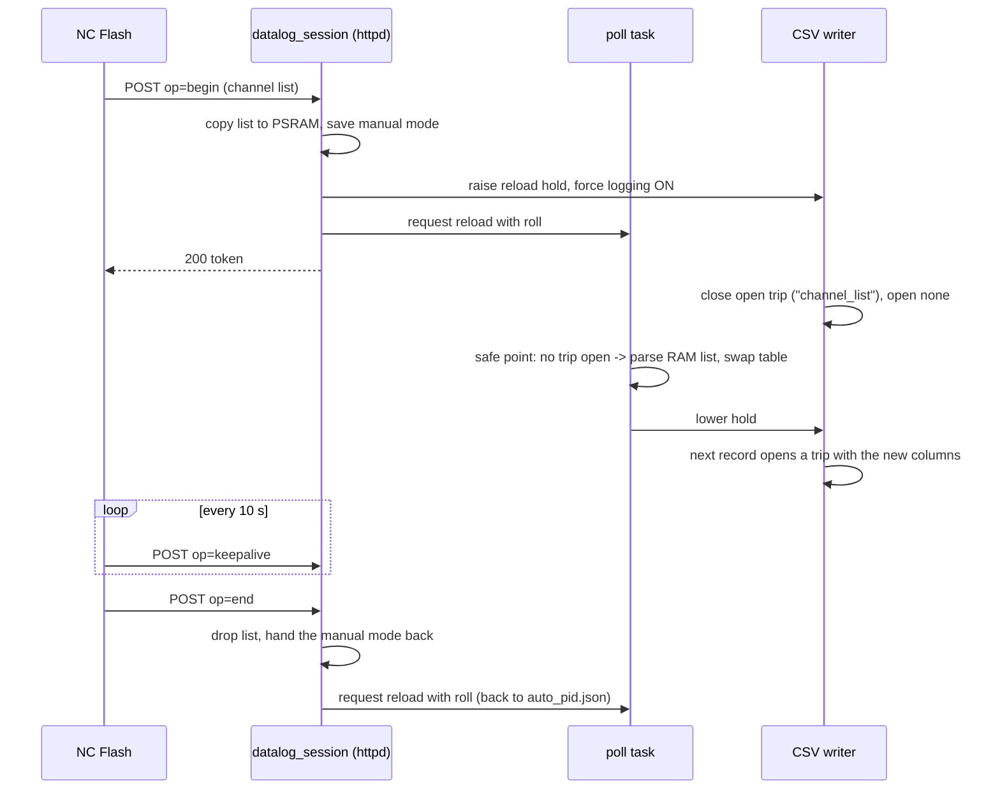

# datalog_session — a temporary channel list for one logging run

`main/datalog_session.c` lets NC Flash log the channels shown in its Datalogger window without
overwriting what the adapter logs on its own.

The PC posts a channel list. It is kept **in RAM only** and stands in for `auto_pid.json` while
the session lasts; the saved file is never written. The session ends when the PC says so, when it
stops sending keepalives, when the adapter goes to sleep, or at a reboot. The adapter then goes
back to its saved list by itself.

Not yet verified on a device: there was no hardware when this was written. The bench checklist is
at the end.

## What it touches, and what it does not

A session changes two things: **which read-only requests the poller sends**, and **whether the
trip logger records**. It never touches `FLASH_ACTIVE_BIT`, a park or claim lease, SLCAN or a
flash path, and it cannot begin while any of those own the bus.

## HTTP contract

`GET /host_caps` reports `"session_list": 1`. Older firmware has no such key and answers 404 on
`/datalog_session`.

| Request | Reply |
|---|---|
| `POST /datalog_session?op=begin[&ttl_s=N]`, body = an `auto_pid.json` document | 200 `{"ok":true,"active":true,"token":N,"ttl_s":N}` |
| `POST /datalog_session?op=keepalive&token=N` | 200 `{"ok":true,"active":true,"remaining_ms":N}` |
| `POST /datalog_session?op=end&token=N` | 200 `{"ok":true,"active":false}` |
| `GET /datalog_session` | 200 `{"ok":true,"active":bool,"remaining_ms":N,"last_end":"host"\|"expired"\|"sleep"\|""}` |

Errors, all as `{"ok":false,"error":"<code>","msg":"<sentence>"}` (`stale` carries no `msg`):

| Status | `error` | When |
|---|---|---|
| 400 | `bad_request` | no or unknown `op`; body missing, over 64 KB (`DLS_BODY_MAX_BYTES`), not JSON, nested deeper than `DLS_JSON_MAX_DEPTH`, or with no `pids` array |
| 409 | `busy` | the flash fence is not clear, a host datalog park or bus claim is raised, or the adapter is going to sleep |
| 409 | `inactive` | the poller is not running, so nothing could swap the list in |
| 409 | `stale` | keepalive or end with no session, or with another token (a missing token counts as another token) |
| 500 | `internal` | out of memory. Not in the host contract; nothing was changed |

Details the PC side depends on:

- `ttl_s` defaults to 30 and is clamped to 10..120 (`dls_clamp_ttl_s()`).
- The token is a non-zero 32-bit number, random per begin.
- A begin while a session is active **replaces** the list and issues a new token. The old token is
  stale from then on. `last_end` is cleared when a *new* session begins, not on a replace.
- A keepalive that arrives after the lease ran out, but before the 1 Hz reaper acted, still
  renews it.
- `busy` wins over `inactive`; the body is checked before either.

`GET /poll_status` gains `"session_list"`: the table the poller has **loaded right now** came from
the temporary list. "Applied" is `session_list:true` with `reload_pending:false`. Read `reload_ok`
only once `reload_pending` is false — before that it still describes the previous reload.

`POST /store_auto_data` during a session writes the file as always, queues no reload, and replies
`"applied":"deferred"`. The saved list takes effect when the session ends.

## Lifecycle

**Begin** (`dls_handle_begin`, httpd task), in this order: read and check the body; take the
session lock; refuse if busy or inactive (`dls_begin_check()`); raise the writer's reload hold and
force logging on; copy the list to PSRAM (`autopid_session_list_set()`); record the session
(`dls_begin()`); request the reload (`poll_log_request_reload_roll()`).

Logging is forced ON for the session — it records whenever the ECU answers, like the web Start
button. The manual mode that was in force is saved once, on the first begin, and handed back at
the end.

**End**, whatever the reason (`dls_end_locked`): drop the RAM list, hand the manual mode back
(`csv_logger_restore_manual_mode()`), request a reload with roll. One event-log line on begin and
one on end.

| Ends by | Who runs it | `last_end` |
|---|---|---|
| `op=end` | httpd task | `host` |
| lease ran out | `datalog_session_tick()`, called first thing each second by `datalog_lease_task` | `expired` |
| sleep entry | `datalog_session_end_for_sleep()`, in the sleep teardown just before `csv_logger_set_sleep_requested()` | `sleep` |
| reboot | nothing to do: the list was only ever in RAM | — |

## Where the table comes from

`load_autopid_config()` reads the `auto_pid.json` document **once** per load
(`load_auto_pid_root`): the RAM list when one is set, else the file. The same parsed document
feeds both the count that sizes the table and the parse that fills it, so the two cannot disagree.
The vehicle-profile file is read as before. The loaded table records its source in
`autopid_config_t.from_session_list`, which is what `/poll_status` reports.

Setting or clearing the list changes nothing by itself — the swap still happens only on the poll
task at its safe point. See [poll_log.md](poll_log.md).

A temporary list that fails to parse (out of memory) fails the load, so the reload is rejected and
the running table stays. A missing *file* still loads as an empty list, as it always did.

## Safety rules

1. **The swap happens only on the poll task, at its safe point, after the park check.** A session
   only sets flags. This is the rule the live-reload UAF proof rests on, and it is unchanged.
2. **No trip file mixes two channel lists.** The table is only swapped while no trip is open; a
   session closes the open trip first (the reload hold, [csv_logger.md](csv_logger.md)).
3. **The hold always lapses** (`CSV_RELOAD_HOLD_MS`, 5 s). A holder that never comes back — parked
   by a host, asleep, wedged — costs a few seconds of log, never the rest of the drive. After
   `POLLLOG_ROLL_MAX_HOLDS` lapsed holds the poll task stops rolling and waits for the trip to end,
   like a saved-list edit.
4. **A rejected list keeps the old table.** `reload_ok` goes false; the PC ends the session.
5. **Never restart the producer under a parked host.** If a host datalog park is raised when a
   session ends, the manual mode is not touched: the saved value goes into the park's pre-pause
   slot, which `datalog_restore_mode()` applies when the park ends. The rule is
   `csv_manual_restore_target()`.
6. **A session cannot begin while the bus is owned** or while the adapter is going to sleep. One
   that is already running when a host parks the bus keeps its lease; its reloads wait for the
   park to end.
7. **The lease reaper runs before the flash checks** in `datalog_lease_task`, so a vanished host's
   list does not outlive its lease because a flash is running. Ending a session touches no CAN
   state.
8. **The list comes from the network and is parsed on the poll task.** Nesting is bounded before
   any parser sees it (`dls_json_depth_ok()`), and the parser's two remaining crash paths on odd
   values were closed: a one-character `PID` no longer leaves an unterminated command, and a
   standard-PID name without a dash no longer reaches `strcmp` as a NULL.

### The park race, worked through

`csv_logger_restore_manual_mode()` can run on the lease or sleep task while `/datalog?op=pause` or
`op=resume` runs on the httpd task, and the park flag is not locked against it. It therefore looks
at the flag again after each write:

| Interleaving | Result |
|---|---|
| Parked throughout | value in the pre-pause slot; mode untouched; the resume applies it |
| Park ends while the slot is being written | the mode is applied directly as well |
| A pause lands just before or after the mode is written | seen by the second look: slot corrected, mode forced back OFF |

What is left needs a session end, a pause and a resume to interleave within a few instructions.
The worst outcome is a wrong manual mode — never a transmit, because the poller's park does not
depend on the manual mode.

## Cross-task state

| State | Written by | Read by | Guard |
|---|---|---|---|
| `s_st` (session record) | httpd, lease task, sleep task | the same | `s_lock` |
| `s_active` in `datalog_session.c` | the same, under `s_lock` | lease tick, sleep teardown | aligned bool; a stale read costs one tick |
| the RAM list (`s_session_json`) | `autopid_session_list_set()` callers | poll task, during a reload | the autopid file lock |
| `s_reload_req` | any task (OR bits in) | poll task (atomic exchange) | atomic builtins |
| `s_session_list`, `s_pid_count` | poll task | httpd (`/poll_status`) | aligned 32-bit / bool |
| reload hold (`s_reload_hold_raised`, `s_reload_hold_deadline_ms`) | poll task; httpd at begin | CSV writer | aligned words, deadline written first, self-expiring |

Lock order is session lock → autopid file lock. The poll task takes the file lock and then the
config mutex, and never the session lock, so there is no cycle. Neither the poll task nor the CSV
writer ever blocks on any of this.

## Known limits

- Forcing logging on creates the writer task if `csv_log` was disabled at boot, exactly as the web
  Start button does. After the session the mode goes back to AUTO, and the writer stays.
- A session that starts with a trip already open closes that trip. That is the point, but it means
  one drive can be two files.

## Bench checklist

Nothing here has been run on hardware. Before release, on the bench PCM:

- [ ] `GET /host_caps` shows `"session_list":1`; `GET /datalog_session` shows `active:false`.
- [ ] Engine off, no trip: begin with 3 channels → `/poll_status` reaches `session_list:true`,
      `reload_pending:false`, `pids:3` within a second; **one** new trip file opens with exactly
      those columns (no stray near-empty file before it); port 35002 shows its header.
- [ ] Trip already open (web Start, or engine running): begin → the open file closes with reason
      `channel_list` in the event log, a new one opens with the new columns, no row of the old file
      has the new columns.
- [ ] Keepalive every 10 s for 3 minutes: the session stays up, `remaining_ms` resets each time.
- [ ] End: the file closes, `/poll_status` shows `session_list:false` and the saved `pids` count,
      `/csv_status` `manual_mode` is what it was before begin, `auto_pid.json` is byte-identical.
- [ ] Stop the keepalives (kill NC Flash): within `ttl_s` + ~1 s the event log shows the list
      ended because NC Flash stopped answering, and the adapter logs its saved list again.
      `GET /datalog_session` shows `last_end:"expired"`; a late keepalive gets 409.
- [ ] Begin a second time while active: new token, old token gets 409, the trip rolls once more.
- [ ] A list with a channel the ECU cannot answer: `pids_unpollable` or timeouts show in
      `/poll_status`, nothing crashes, end restores the saved list.
- [ ] Malformed bodies: not JSON, `{"pids":5}`, 70 KB, 100 nested `[` → 400 each, no reload queued,
      no reboot. `{"pids":[{"PID":"1"},{"PID":7},5,"x"]}` → accepted, `pids_unpollable` non-zero,
      no crash.
- [ ] Begin during an NC Flash ECU session (bus claim held) → 409 `busy`.
- [ ] Session running, then `/datalog?op=pause`: the poller parks. End the session while parked →
      `/datalog` still shows `manual_mode:"off"`; after `op=resume` the mode is the pre-session
      one and the saved list is loaded before the first sweep.
- [ ] Session running, let the adapter go to sleep: event log shows the list ended for sleep; on
      wake `/poll_status` shows `session_list:false` and the logger is not forced on.
- [ ] `POST /store_auto_data` during a session → `"applied":"deferred"`, `reload_pending` stays
      false, and the new saved list is what loads when the session ends.
- [ ] `/store_auto_data` with **no** session still behaves as before: `live` with no trip,
      `deferred` under a trip and applied when it ends.
- [ ] A full ECU read and a flash with no session involved, as a regression check on the lease
      task change.
- [ ] Free internal RAM (`/check_status`) before, during and after a session: no downward step
      after ten begin/end cycles.
